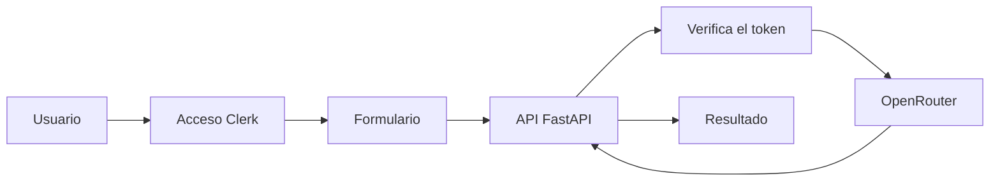
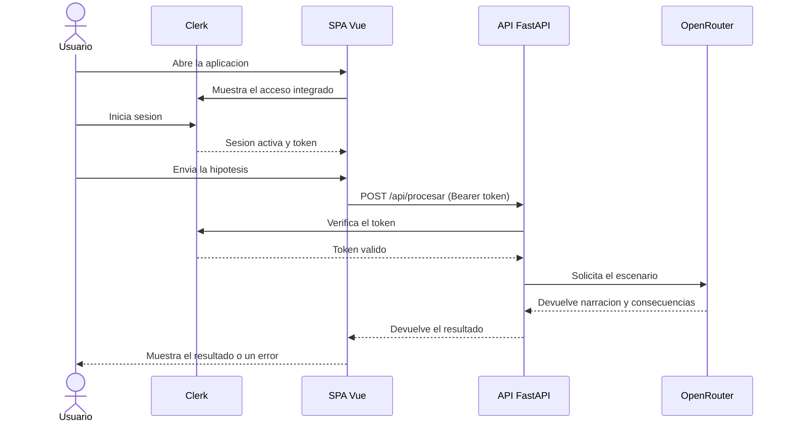

# App2 WhatIf — ¿Qué habría pasado si...?

SPA de una sola pantalla para explorar historias alternativas, protegida con inicio de sesión. Vue 3/Vite presenta el acceso de Clerk y el formulario; FastAPI valida la sesión y llama una vez a OpenRouter. No hay persistencia. El proyecto se ha desarrollado en clase por Mario Hernández y Alejandro Suárez, como segunda versión de la aplicación [¿Qué habría pasado si...?](../01appdesarrollo-whatif/README.md).

## Datos del documento

| Campo | Valor |
|---|---|
| Nombre del proyecto | App2 WhatIf — ¿Qué habría pasado si...? |
| Autores | Mario Hernández y Alejandro Suárez |
| Fecha | 13/10/2026 |

### Historial de cambios

| Versión | Fecha | Autor | Cambios realizados |
|---|---|---|---|
| 0.1 | 12/10/2026 | Mario Hernández y Alejandro Suárez | Documentación generada con Spec Kit (constitución, especificación, plan y tareas) antes de programar. |
| 1.0 | 13/10/2026 | Mario Hernández y Alejandro Suárez | README reorganizado como ERS siguiendo la plantilla del docente, a partir de los documentos de Spec Kit y del código ya implementado. |

## 1. Introducción

### 1.1. Propósito del documento

Este documento describe qué debe hacer App2 WhatIf y las condiciones que debe cumplir. Sirve de referencia para el equipo de desarrollo durante la implementación y las pruebas, y para que el docente pueda comprobar que el resultado final cumple lo especificado. Gran parte de esta información ya existía, repartida en los documentos que genera la herramienta Spec Kit dentro de `specs/001-historia-alternativa/`; aquí se reúne y se ordena según la plantilla de la asignatura. Qué es Spec Kit y cómo se usó se explica aparte en [docs/speckit-explicado.md](docs/speckit-explicado.md).

### 1.2. Problema y objetivos

**Problema o necesidad:** igual que en la primera aplicación, resulta entretenido imaginar cómo habría cambiado la historia si un hecho concreto hubiera ocurrido de otra manera, pero sin control de acceso cualquiera podría agotar las peticiones a la IA. Esta segunda versión resuelve la misma necesidad que la App 1, añadiendo una identidad verificada antes de generar nada.

| ID | Objetivo del proyecto | Indicador de logro |
|---|---|---|
| OBJ-01 | Permitir que una persona autenticada plantee una hipótesis histórica y reciba una historia alternativa generada por IA. | Con una sesión válida y datos correctos, aparecen la narración y entre 3 y 5 consecuencias. |
| OBJ-02 | Impedir que se use la IA sin haber iniciado sesión. | Cualquier envío sin un token válido de Clerk recibe un rechazo HTTP 401 y no se llega a llamar a la IA. |
| OBJ-03 | Mantener todo en una sola pantalla, sin cuentas propias ni almacenamiento. | No existe ninguna otra ruta o pantalla, y no se conservan datos tras cerrar sesión o recargar. |

### 1.3. Alcance

**El sistema incluirá:**

- Un formulario para escribir la pregunta, elegir el año y elegir el estilo (igual que en la App 1).
- El acceso, inicio y cierre de sesión con Clerk, integrados en la misma pantalla.
- Un backend FastAPI que verifica el token de Clerk y llama una sola vez a OpenRouter.
- La visualización de la narración y las consecuencias, con sus estados de carga y error.
- Una preparación de despliegue en AWS, con la aplicación completa en una instancia EC2 mediante Docker Compose.

**Queda fuera del alcance:**

- Guardar un historial de preguntas o resultados anteriores.
- Crear un sistema de usuarios propio (roles, perfiles, panel de administración) más allá de la sesión que gestiona Clerk.
- Compartir o exportar el resultado.
- Cualquier otra pantalla o ruta de navegación distinta de la principal.
- Desplegar en Vercel: se había dejado preparado como alternativa, pero el plan actual es desplegar todo en AWS (ver [docs/despliegue-aws-ec2.md](docs/despliegue-aws-ec2.md)).

### 1.4. Definiciones y abreviaturas

| Término | Definición |
|---|---|
| ERS | Especificación de Requisitos del Software. |
| IA | Inteligencia artificial; en este caso, el modelo de lenguaje que genera la historia alternativa. |
| Nivel de irrealismo | Estilo de la respuesta: realista, ilusionante o descerebrado. |
| SPA | Single Page Application: aplicación web que vive en una sola pantalla, sin cambiar de ruta. |
| Clerk | Servicio externo que gestiona el inicio y el cierre de sesión de los usuarios; la aplicación no guarda contraseñas propias. |
| Token Bearer | Credencial que Clerk entrega al iniciar sesión y que el navegador envía al backend para demostrar que la persona está identificada. |
| FastAPI / Pydantic | Framework y librería de Python usados en el backend para definir la API y validar los datos de entrada y salida. |
| Spec Kit (speckit) | Metodología y herramienta usada para escribir primero la documentación técnica del proyecto (constitución, especificación, plan y tareas) y generar después el código a partir de ella. Ver [docs/speckit-explicado.md](docs/speckit-explicado.md). |

### 1.5. Referencias y fuentes

| ID | Fuente | Fecha o versión | Ubicación |
|---|---|---|---|
| FUE-01 | Enunciado de la práctica proporcionado por el docente (el mismo que el de la App 1, "equivalente en necesidad a App 1"). | [Pendiente] | Carpeta raíz del workspace. |
| FUE-02 | Documentación oficial de Clerk (autenticación). | Consultada durante el desarrollo. | https://clerk.com/docs |
| FUE-03 | Documentación oficial de OpenRouter. | Consultada durante el desarrollo. | https://openrouter.ai |
| FUE-04 | Documentos generados con Spec Kit: constitución, especificación, plan y tareas de esta misma funcionalidad. | 12/10/2026 | `specs/001-historia-alternativa/` |

## 2. Descripción general del sistema

### 2.1. Contexto y perspectiva del producto

Es una SPA nueva e independiente. A diferencia de la App 1, añade una frontera de autenticación con Clerk antes de poder usar la IA, y el backend está escrito en Python (FastAPI) en lugar de en el servidor de Nuxt. El proyecto se construyó primero generando la documentación técnica con la metodología Spec Kit (constitución → especificación → plan → tareas) y después implementando el código siguiendo esos documentos; el detalle de ese proceso está en [docs/speckit-explicado.md](docs/speckit-explicado.md) y el registro de lo que se le pidió a la IA en cada fase, en [docs/uso-ia.md](docs/uso-ia.md).

### 2.2. Personas interesadas y tipos de usuario

| ID | Persona, colectivo o rol | Necesidad o responsabilidad | Permisos y conocimientos relevantes |
|---|---|---|---|
| ACT-01 | Usuario de la aplicación | Iniciar sesión, escribir una hipótesis y leer la historia alternativa. | Necesita una cuenta en el proyecto Clerk configurado; no requiere conocimientos técnicos. |
| ACT-02 | Persona que pone en marcha el proyecto (desarrollador) | Configurar las claves de Clerk y de OpenRouter, y ejecutar backend y frontend. | Conocimientos básicos de Python/FastAPI y de Node.js/Vue; acceso a los archivos `.env`. |
| ACT-03 | Docente o evaluador | Comprobar que la aplicación cumple los requisitos descritos. | Acceso al código, a `specs/001-historia-alternativa/` y a este documento. |

### 2.3. Funciones principales

- Iniciar y cerrar sesión con Clerk, integrado en la misma pantalla.
- Escribir una pregunta de hasta 280 caracteres.
- Elegir un año de referencia entre 0 y 3000.
- Elegir el estilo de la respuesta (realista, ilusionante o descerebrado).
- Generar y mostrar una historia alternativa con sus consecuencias, una sola vez por envío.
- Mostrar los estados de carga y de error sin exponer datos internos ni duplicar peticiones.

### 2.4. Entorno de uso

| Aspecto | Descripción |
|---|---|
| Dispositivos y plataformas | Navegador de escritorio o móvil, cualquier sistema operativo moderno. |
| Condiciones de uso | Requiere conexión a internet y una cuenta válida en el proyecto Clerk configurado. |
| Volumen esperado | Uso individual en un entorno de clase o pruebas; no se ha dimensionado para tráfico alto. |

### 2.5. Restricciones

| ID | Restricción | Origen o justificación |
|---|---|---|
| RES-01 | El backend debe usar Python, FastAPI y validación con Pydantic; el frontend debe ser una SPA de Vue 3, Vite y Tailwind CSS, sin `vue-router`. | Decisión del equipo, recogida en la constitución del proyecto (`.specify/memory/constitution.md`). |
| RES-02 | No se puede procesar ninguna hipótesis sin una identidad autenticada y autorizada por Clerk. | Requisito de seguridad acordado en la especificación. |
| RES-03 | OpenRouter es el único proveedor de IA; el modelo se configura por variable de entorno. | Igual que en la App 1. |
| RES-04 | No se guardan hipótesis ni resultados en almacenamiento persistente, `localStorage`, `sessionStorage`, IndexedDB ni base de datos. | Alcance mínimo acordado: la app no tiene memoria propia. |
| RES-05 | La interfaz y los mensajes deben estar en español; los identificadores de código, en inglés. | Decisión del equipo. |

### 2.6. Suposiciones y dependencias

| ID | Tipo | Descripción | Consecuencia si no se cumple |
|---|---|---|---|
| SUP-01 | Suposición | La persona que despliega la aplicación dispone de un proyecto Clerk de desarrollo y de una clave de API de OpenRouter válidas. | Sin ellas, nadie puede iniciar sesión ni generar ninguna historia. |
| DEP-01 | Dependencia | Servicio externo Clerk (autenticación). | Si no está disponible o cambia su API, nadie puede identificarse y la app queda inutilizable. |
| DEP-02 | Dependencia | Servicio externo OpenRouter. | Si no está disponible o cambia su API, la generación de historias falla. |
| DEP-03 | Dependencia | Python 3.12 + uv, y Node.js + npm instalados en el equipo de desarrollo. | Sin ellos no se puede instalar ni ejecutar el proyecto. |

## 3. Requisitos funcionales

**Prioridades:** Alta = imprescindible para la versión prevista; Media = importante, pero puede aplazarse mediante acuerdo; Baja = deseable.

### 3.1. Catálogo de requisitos funcionales

| ID | Nombre | Prioridad | Fuente | Estado |
|---|---|---|---|---|
| RF-01 | Escribir la pregunta | Alta | FUE-01 | Validado |
| RF-02 | Elegir el año de referencia | Alta | FUE-01 | Validado |
| RF-03 | Elegir el estilo de la respuesta | Alta | FUE-01 | Validado |
| RF-04 | Iniciar sesión con Clerk en la misma pantalla | Alta | FUE-04 (spec.md, US2) | Validado |
| RF-05 | Generar y mostrar el escenario autenticado | Alta | FUE-04 (spec.md, US1) | Validado |
| RF-06 | Bloquear envíos duplicados mientras se espera respuesta | Media | FUE-04 (spec.md, US3) | Validado |
| RF-07 | Cerrar sesión desde la misma pantalla | Media | FUE-04 (spec.md, US2) | Validado |
| RF-08 | Mostrar errores comprensibles sin datos internos | Media | FUE-04 (spec.md, US3) | Validado |

### 3.2. Fichas de requisito funcional

#### RF-01. Escribir la pregunta

| Campo | Descripción |
|---|---|
| Enunciado | El sistema deberá permitir que el usuario escriba una pregunta obligatoria de hasta 280 caracteres. |
| Justificación | La pregunta es la hipótesis sobre la que la IA construye la historia; sin ella no se puede generar nada. |
| Actor | Usuario (ACT-01) |
| Prioridad | Alta |
| Fuente | FUE-01 |
| Precondiciones | El usuario ha iniciado sesión y ve el formulario. |
| Entradas | Texto de la pregunta. |
| Comportamiento esperado | El sistema permite escribir y editar la pregunta, mostrando el recuento de caracteres. |
| Salidas y postcondiciones | La pregunta queda guardada en el estado de la página hasta que se envía o se reinicia el formulario. |
| Errores o alternativas | Si la pregunta está vacía (o solo tiene espacios) o supera los 280 caracteres, el sistema impide el envío y el backend la rechaza igualmente con HTTP 422. |
| Dependencias | RF-05 |

**Criterios de aceptación:**

- **CA-RF01-01:** Dado el formulario, cuando el usuario escribe una pregunta de 280 caracteres o menos y pulsa enviar, entonces el sistema la acepta y continúa con la petición.
- **CA-RF01-02:** Dado el formulario, cuando el usuario deja la pregunta vacía o escribe más de 280 caracteres, entonces el sistema rechaza la petición sin llamar a la IA.

#### RF-02. Elegir el año de referencia

| Campo | Descripción |
|---|---|
| Enunciado | El sistema deberá permitir elegir un año entero entre 0 y 3000, ambos incluidos. |
| Justificación | El año da contexto histórico a la hipótesis planteada. |
| Actor | Usuario (ACT-01) |
| Prioridad | Alta |
| Fuente | FUE-01 |
| Precondiciones | El usuario ha iniciado sesión y ve el formulario. |
| Entradas | Año elegido en el campo numérico. |
| Comportamiento esperado | El campo solo permite valores enteros; el backend vuelve a comprobar el rango con Pydantic. |
| Salidas y postcondiciones | El año queda guardado en el estado de la página junto con el resto de datos del formulario. |
| Errores o alternativas | Un año fuera de 0–3000, o no entero, se rechaza en el formulario y, si llegara igualmente, con HTTP 422 en el backend. |
| Dependencias | RF-05 |

**Criterios de aceptación:**

- **CA-RF02-01:** Dado el campo de año, cuando el usuario introduce 0 o 3000, entonces el sistema acepta el valor.
- **CA-RF02-02:** Dado el campo de año, cuando se envía un valor menor que 0, mayor que 3000 o no entero, entonces el sistema lo rechaza.

#### RF-03. Elegir el estilo de la respuesta

| Campo | Descripción |
|---|---|
| Enunciado | El sistema deberá permitir elegir entre los estilos realista, ilusionante y descerebrado. |
| Justificación | El estilo determina el tono con el que la IA debe redactar la historia. |
| Actor | Usuario (ACT-01) |
| Prioridad | Alta |
| Fuente | FUE-01 |
| Precondiciones | El usuario ha iniciado sesión y ve el formulario. |
| Entradas | Estilo elegido entre las tres opciones. |
| Comportamiento esperado | Solo se ofrecen los tres estilos admitidos; el backend valida que el valor recibido sea exactamente uno de ellos. |
| Salidas y postcondiciones | El estilo queda guardado en el estado de la página junto con el resto de datos del formulario. |
| Errores o alternativas | Un valor distinto de los tres permitidos se rechaza con HTTP 422 antes de llamar a la IA. |
| Dependencias | RF-05 |

**Criterios de aceptación:**

- **CA-RF03-01:** Dado el selector de estilo, cuando el usuario elige uno de los tres estilos, entonces el sistema lo acepta.
- **CA-RF03-02:** Dado un valor de estilo distinto de los tres permitidos, cuando llega a la API, entonces el sistema lo rechaza con un error de validación.

#### RF-04. Iniciar sesión con Clerk en la misma pantalla

| Campo | Descripción |
|---|---|
| Enunciado | El sistema deberá mostrar el acceso de Clerk integrado en la propia pantalla, sin modal ni cambio de ruta, cuando no haya una sesión activa. |
| Justificación | El procesamiento debe estar protegido y el acceso no puede depender de ocultar el botón de envío. |
| Actor | Usuario (ACT-01) |
| Prioridad | Alta |
| Fuente | FUE-04 (spec.md, US2) |
| Precondiciones | El usuario abre la aplicación sin una sesión de Clerk activa. |
| Entradas | Credenciales que la persona introduce en el formulario de Clerk. |
| Comportamiento esperado | Clerk gestiona el inicio de sesión dentro del mismo componente visual; al completarse, la pantalla muestra el formulario de hipótesis. |
| Salidas y postcondiciones | La aplicación dispone de un token de sesión que se usará en cada petición al backend. |
| Errores o alternativas | Mientras la sesión no esté cargada o confirmada, se muestra un estado de comprobación en lugar del formulario de hipótesis. |
| Dependencias | RF-05, INT-01 |

**Criterios de aceptación:**

- **CA-RF04-01:** Dado que la persona no tiene sesión, cuando abre la aplicación, entonces encuentra el acceso de Clerk integrado en esa misma pantalla, sin modal ni otra ruta.
- **CA-RF04-02:** Dado que la persona completa el inicio de sesión, cuando Clerk confirma la sesión, entonces la pantalla muestra el formulario de hipótesis en lugar del acceso.

#### RF-05. Generar y mostrar el escenario autenticado

| Campo | Descripción |
|---|---|
| Enunciado | El sistema deberá enviar la pregunta, el año y el estilo, junto con el token de sesión, y mostrar la narración y las consecuencias que devuelva la IA. |
| Justificación | Es la función principal de la aplicación, ahora solo disponible para una identidad verificada. |
| Actor | Usuario (ACT-01) |
| Prioridad | Alta |
| Fuente | FUE-04 (spec.md, US1) |
| Precondiciones | RF-01, RF-02, RF-03 y RF-04 cumplidos (datos válidos y sesión activa). |
| Entradas | Pregunta, año, estilo y token Bearer de Clerk. |
| Comportamiento esperado | El backend verifica primero el token; si es válido, valida los datos y llama una sola vez a OpenRouter. Si la respuesta tiene el formato esperado, devuelve una narración y entre 3 y 5 consecuencias, sin incluir la pregunta original. |
| Salidas y postcondiciones | El componente de resultado muestra la narración y las consecuencias. |
| Errores o alternativas | Sin token válido: HTTP 401, sin llamar a la IA. Datos inválidos: HTTP 422. Fallo o salida no utilizable del proveedor: HTTP 502. Tiempo de espera agotado (25 segundos): HTTP 504. |
| Dependencias | RF-01, RF-02, RF-03, RF-04, INT-01, INT-02 |

**Criterios de aceptación:**

- **CA-RF05-01:** Dada una sesión válida y datos válidos, cuando el usuario envía el formulario, entonces el sistema muestra la narración y al menos 3 consecuencias generadas por la IA, y se realiza exactamente una llamada al proveedor.
- **CA-RF05-02:** Dada una sesión sin token válido, cuando se intenta procesar una hipótesis (incluso llamando directamente a la API), entonces el sistema responde con HTTP 401 y no llama a la IA.

#### RF-06. Bloquear envíos duplicados mientras se espera respuesta

| Campo | Descripción |
|---|---|
| Enunciado | El sistema deberá impedir que un segundo envío inicie otra solicitud mientras la anterior está pendiente. |
| Justificación | Evita gastar llamadas a la IA por error y mantiene un único resultado visible. |
| Actor | Usuario (ACT-01) |
| Prioridad | Media |
| Fuente | FUE-04 (spec.md, US3) |
| Precondiciones | Hay una petición de generación en curso. |
| Entradas | Ninguna adicional; es un segundo intento de envío. |
| Comportamiento esperado | El botón de envío se deshabilita mientras se espera respuesta; un resultado nuevo sustituye siempre al anterior. |
| Salidas y postcondiciones | Solo queda visible el resultado más reciente; no se acumula historial. |
| Errores o alternativas | No aplica. |
| Dependencias | RF-05 |

**Criterios de aceptación:**

- **CA-RF06-01:** Dada una solicitud pendiente, cuando la persona intenta enviarla de nuevo, entonces el segundo envío se bloquea y no se generan peticiones adicionales al proveedor.

#### RF-07. Cerrar sesión desde la misma pantalla

| Campo | Descripción |
|---|---|
| Enunciado | El sistema deberá permitir cerrar la sesión de Clerk desde la misma pantalla, sin cambiar de ruta. |
| Justificación | Completa el ciclo de acceso: quien puede entrar también debe poder salir sin salir de la aplicación. |
| Actor | Usuario (ACT-01) |
| Prioridad | Media |
| Fuente | FUE-04 (spec.md, US2) |
| Precondiciones | El usuario tiene una sesión activa. |
| Entradas | Acción de "Cerrar sesión". |
| Comportamiento esperado | Clerk cierra la sesión y la interfaz vuelve al estado de acceso; se descarta el resultado mostrado. |
| Salidas y postcondiciones | Cualquier envío posterior sin volver a autenticarse recibe HTTP 401 antes de llamar a la IA. |
| Errores o alternativas | No aplica. |
| Dependencias | RF-04, RF-05 |

**Criterios de aceptación:**

- **CA-RF07-01:** Dada una sesión activa, cuando la persona elige cerrar sesión, entonces la interfaz vuelve al estado de acceso y el resultado anterior desaparece.
- **CA-RF07-02:** Dada una sesión recién cerrada, cuando se intenta procesar una hipótesis sin volver a iniciar sesión, entonces el sistema responde con HTTP 401.

#### RF-08. Mostrar errores comprensibles sin datos internos

| Campo | Descripción |
|---|---|
| Enunciado | El sistema deberá mostrar un mensaje de error comprensible en español ante datos inválidos, fallos del proveedor o respuestas no utilizables, sin revelar detalles internos. |
| Justificación | Los errores deben ser distinguibles para el usuario sin exponer trazas, tokens ni la respuesta completa del proveedor. |
| Actor | Usuario (ACT-01) |
| Prioridad | Media |
| Fuente | FUE-04 (spec.md, US3) |
| Precondiciones | Una petición termina en error (entrada inválida, fallo del proveedor, timeout o salida no utilizable). |
| Entradas | Ninguna adicional. |
| Comportamiento esperado | El backend devuelve un JSON de error estable (`{"error":{"code":"...","message":"..."}}`); el frontend traduce el código HTTP a un mensaje en español. |
| Salidas y postcondiciones | Se muestra el mensaje de error en lugar de un resultado; los datos ya escritos no se pierden. |
| Errores o alternativas | No aplica (esta es la propia gestión de errores). |
| Dependencias | RF-05 |

**Criterios de aceptación:**

- **CA-RF08-01:** Dado un fallo del proveedor, una respuesta vacía o una respuesta mal formada, cuando termina la petición, entonces se muestra un error seguro y comprensible, sin texto del proveedor ni datos internos.

## 4. Requisitos no funcionales

| ID | Categoría | Requisito medible | Condiciones de comprobación | Criterio de aceptación | Prioridad |
|---|---|---|---|---|---|
| RNF-01 | Seguridad y privacidad | FastAPI debe verificar realmente el token de Clerk (no solo decodificarlo) antes de llamar a la IA; las claves secretas solo viven en el backend. | Revisión del código (`app/auth.py`, `app/config.py`) y de las peticiones de red visibles desde el navegador. | La clave secreta de Clerk y la de OpenRouter no aparecen en ningún archivo del cliente ni en el bundle; una petición sin token válido nunca llega a `OpenRouterProvider`. | Alta |
| RNF-02 | Fiabilidad | Los datos de entrada deben validarse también en el servidor, no solo en el formulario. | Enviar una petición directamente a `/api/procesar` con datos inválidos, sin pasar por el formulario. | La API responde con HTTP 422 y no llega a llamar a OpenRouter. | Alta |
| RNF-03 | Usabilidad | La interfaz y los mensajes, incluidos los de error, deben mostrarse en español. | Revisión visual de todas las pantallas y mensajes de la aplicación. | Ningún texto de la interfaz aparece en otro idioma. | Media |
| RNF-04 | Rendimiento | La llamada al proveedor de IA debe tener un tiempo máximo de espera de 25 000 ms, sin reintentos automáticos del SDK. | Simular una respuesta de OpenRouter que no llega en ese plazo. | El backend responde HTTP 504 con el mensaje de tiempo agotado, sin bloquear el resto de la aplicación. | Alta |
| RNF-05 | Privacidad (no persistencia) | La aplicación no debe guardar hipótesis ni resultados en ningún almacenamiento persistente. | Auditoría del código en `backend/app/` y `frontend/src/` buscando `localStorage`, `sessionStorage`, IndexedDB o acceso a base de datos. | No se encuentra ningún uso de almacenamiento persistente para estos datos (ver [docs/validacion.md](docs/validacion.md)). | Alta |
| RNF-06 | Compatibilidad / despliegue | La aplicación debe poder desplegarse completa en una instancia EC2 de AWS, con Docker Compose levantando frontend y backend detrás de un proxy. | Ejecutar `docker compose -f deploy/docker-compose.yml config --quiet` localmente y, en la instancia EC2, `docker compose -f deploy/docker-compose.yml up --build`. | Ambos comandos terminan sin errores y la aplicación responde en la IP/dominio de la instancia (ver [docs/despliegue-aws-ec2.md](docs/despliegue-aws-ec2.md)). | Media |

## 5. Datos y reglas de negocio

### 5.1. Información que gestionará el sistema

| ID | Entidad o conjunto de datos | Campos principales | Validaciones | Acceso y conservación |
|---|---|---|---|---|
| DAT-01 | Hipótesis (`ScenarioRequest`) | `question` (texto), `year` (entero), `unrealismLevel` (texto) | `question`: 1 a 280 caracteres tras quitar espacios exteriores. `year`: entero entre 0 y 3000. `unrealismLevel`: debe ser `realista`, `ilusionante` o `descerebrado`. | Solo existe en memoria mientras se procesa la petición; no se guarda en ningún archivo ni base de datos. |
| DAT-02 | Escenario alternativo (`ScenarioResult`) | `narrative` (texto), `consequences` (lista de textos) | `narrative` no vacío; `consequences` entre 3 y 5 textos no vacíos. No incluye la pregunta original. | Se muestra en pantalla y se pierde al recargar la página, cerrar sesión o reiniciar el formulario; no se persiste. |
| DAT-03 | Sesión autenticada (identidad de Clerk) | Token Bearer y los datos (`iss`, `azp`, `aud`) que Clerk incluye en él. | El backend comprueba que el emisor (`iss`) y, si procede, la parte autorizada (`azp`) y la audiencia (`aud`) coinciden con los configurados. | Solo se usa para autenticar la petición; no se copia a un sistema propio ni se amplía con roles o perfiles de la aplicación. |

### 5.2. Reglas de negocio

| ID | Regla | Requisitos relacionados | Fuente |
|---|---|---|---|
| RN-01 | El año debe ser un número entero entre 0 y 3000; no se permiten decimales ni valores fuera de ese rango. | RF-02 | FUE-01, decisión del equipo |
| RN-02 | El estilo de la respuesta debe ser siempre uno de los tres valores admitidos; cualquier otro valor se rechaza. | RF-03 | Decisión del equipo |
| RN-03 | Cada envío válido y autenticado debe producir exactamente una llamada al proveedor de IA. Los datos inválidos, las solicitudes no autorizadas y los envíos duplicados deben producir cero llamadas adicionales. | RF-05, RF-06 | FUE-04 (spec.md, FR-005) |
| RN-04 | La respuesta de éxito nunca incluye la pregunta original ni el objeto completo que devuelve el proveedor. | RF-05, RF-08 | FUE-04 (spec.md, FR-006) |
| RN-05 | No se conservan hipótesis ni resultados en almacenamiento persistente; solo pueden existir transitoriamente en memoria durante el procesamiento y la visualización. | RF-05, RNF-05 | FUE-04 (constitution.md) |

## 6. Interfaces externas

### 6.1. Interfaz de usuario

| ID | Pantalla o interacción | Usuarios | Información y acciones necesarias | Requisitos relacionados |
|---|---|---|---|---|
| IU-01 | Acceso de Clerk (inicio de sesión) | Usuario | Formulario de inicio de sesión de Clerk, integrado en la pantalla principal. | RF-04 |
| IU-02 | Formulario de la hipótesis | Usuario | Campo de pregunta, campo de año, selector de estilo y botón de envío. | RF-01, RF-02, RF-03, RF-06 |
| IU-03 | Resultado del escenario y cierre de sesión | Usuario | Narración, lista de consecuencias, indicador de carga, mensaje de error y acción de cerrar sesión. | RF-05, RF-07, RF-08 |

Las pantallas reales son los componentes Vue del proyecto (`ClerkAccess.vue`, `HypothesisForm.vue` y `ScenarioResult.vue`, coordinados desde `App.vue`); no se han hecho bocetos aparte.

### 6.2. Interfaces con otros sistemas o dispositivos

| ID | Sistema o dispositivo externo | Información intercambiada | Dirección y momento del intercambio | Formato o protocolo exigido | Respuesta ante fallos |
|---|---|---|---|---|---|
| INT-01 | Clerk (autenticación) | El frontend recibe un token de sesión al iniciar sesión; el backend recibe ese token como cabecera `Authorization: Bearer` y lo verifica contra Clerk. | Entrada y salida continua mientras dura la sesión. | Token JWT verificado con el SDK oficial de Clerk (`clerk-backend-api`). | Un token ausente, inválido, caducado o con emisor/audiencia incorrectos se rechaza con HTTP 401 antes de llamar a la IA. |
| INT-02 | OpenRouter (API de chat) | Se envían la pregunta, el año y el estilo convertidos en un mensaje de texto; se recibe un JSON con `narrative` y `consequences`. | Salida al procesar una hipótesis válida; entrada al recibir la respuesta de la IA. | JSON, con el modelo configurado en `OPENROUTER_MODEL` y un tiempo máximo de 25 000 ms. | Si OpenRouter no responde, responde vacío, tarda demasiado o devuelve un formato incorrecto, la API responde con HTTP 502 o 504 sin romper la aplicación. |

## 7. Casos de uso o escenarios de usuario

### CU-01. Autenticarse con Clerk

| Campo | Descripción |
|---|---|
| Objetivo | Obtener una sesión válida para poder usar el generador de escenarios. |
| Actor principal | Usuario (ACT-01) |
| Precondiciones | La aplicación está cargada y el proyecto Clerk está correctamente configurado. |
| Evento de inicio | El usuario abre la aplicación sin sesión activa. |
| Requisitos relacionados | RF-04, RF-07, INT-01 |

**Flujo principal:**

1. El usuario abre la aplicación y ve el acceso de Clerk integrado en la pantalla.
2. El usuario introduce sus credenciales en el formulario de Clerk.
3. Clerk confirma la sesión y entrega un token.
4. La pantalla muestra el formulario de hipótesis en lugar del acceso.

**Flujos alternativos y excepciones:**

- **A1 — Cerrar sesión:** en cualquier momento con sesión activa, si el usuario elige "Cerrar sesión", Clerk cierra la sesión, se descarta el resultado visible y la pantalla vuelve al estado de acceso.

**Postcondiciones:** el usuario tiene (o ya no tiene) un token de sesión válido que determina si puede usar el formulario de hipótesis.

### CU-02. Generar un escenario alternativo

| Campo | Descripción |
|---|---|
| Objetivo | Obtener una historia alternativa a partir de una hipótesis, estando autenticado. |
| Actor principal | Usuario (ACT-01) |
| Precondiciones | El usuario tiene una sesión de Clerk activa (CU-01 completado). |
| Evento de inicio | El usuario rellena el formulario y pulsa enviar. |
| Requisitos relacionados | RF-01, RF-02, RF-03, RF-05, RF-06, RF-08, RN-01, RN-02, RN-03, INT-02 |

**Flujo principal:**

1. El usuario escribe la pregunta, elige el año y elige el estilo.
2. El usuario envía el formulario; el botón se deshabilita mientras se espera respuesta.
3. El backend verifica el token de sesión y valida los datos.
4. El backend envía la petición a OpenRouter y recibe la narración y las consecuencias.
5. El sistema muestra el resultado y vuelve a habilitar el envío.

**Flujos alternativos y excepciones:**

- **A1 — Datos inválidos:** en el paso 1 o 3, si algún dato no es válido, el sistema no envía la petición a la IA y lo indica en el formulario (o con HTTP 422 si llega directamente a la API); el flujo termina.
- **A2 — Sesión no válida:** en el paso 3, si el token ha caducado o no existe, el backend responde HTTP 401 sin llamar a la IA; la interfaz pide iniciar sesión de nuevo.
- **A3 — Fallo o timeout del proveedor:** en el paso 4, si OpenRouter falla, no responde a tiempo o devuelve un formato incorrecto, el sistema muestra un mensaje de error (HTTP 502 o 504) sin perder los datos escritos.

**Postcondiciones:** si todo va bien, el usuario ve la historia generada; si falla, ve un mensaje de error comprensible y puede corregir o volver a intentarlo.

## 8. Verificación y trazabilidad

| Requisito | Objetivo o necesidad de origen | Criterio de aceptación | ID de prueba | Método y datos de comprobación | Resultado esperado |
|---|---|---|---|---|---|
| RF-01 | OBJ-01 / FUE-01 | CA-RF01-01, CA-RF01-02 | `test_models.py` | Pruebas unitarias con preguntas vacías, de 280 y de 281 caracteres. | Las preguntas válidas se aceptan; las inválidas se rechazan. |
| RF-02 | OBJ-01 / FUE-01 | CA-RF02-01, CA-RF02-02 | `test_models.py` | Pruebas unitarias con años límite (0, 3000) y fuera de rango. | Los límites se aceptan; los valores fuera de rango se rechazan. |
| RF-03 | OBJ-01 / FUE-01 | CA-RF03-01, CA-RF03-02 | `test_models.py` | Pruebas unitarias con los tres estilos y uno no permitido. | Los tres estilos se aceptan; un valor desconocido se rechaza. |
| RF-04 | OBJ-02 / FUE-04 | CA-RF04-01, CA-RF04-02 | `test_auth.py` (unit e integration) | Pruebas con verificador Clerk simulado: sin token, token inválido/caducado, token válido. | Sin token válido no hay acceso; con token válido se muestra el formulario. |
| RF-05 | OBJ-01 / FUE-04 | CA-RF05-01, CA-RF05-02 | `test_scenario_api.py` | Petición autorizada con proveedor simulado: éxito con `narrative` y `consequences`, y exactamente una llamada al proveedor. | Se obtiene el resultado esperado con una sola llamada simulada. |
| RF-06 | OBJ-03 / FUE-04 | CA-RF06-01 | `test_scenario_api.py` | Prueba manual/interfaz: intentar un segundo envío mientras el primero está pendiente. | El segundo envío se bloquea; no hay llamadas adicionales. |
| RF-07 | OBJ-02 / FUE-04 | CA-RF07-01, CA-RF07-02 | `test_auth.py` (integration) | Simular cierre de sesión y repetir la petición sin volver a autenticarse. | Tras cerrar sesión, la petición responde HTTP 401. |
| RF-08 | OBJ-01 / FUE-04 | CA-RF08-01 | `test_scenario_errors.py` | Simular fallo del proveedor, timeout y respuesta vacía o mal formada. | Se devuelven los códigos 502/504 documentados, sin datos internos. |
| RNF-01 | RES-02 | Criterio de la sección 4 | `test_auth.py`, `test_openrouter.py` | Revisión del código y de las peticiones de red desde el navegador. | Las claves secretas no aparecen en el cliente; sin token no se llega a OpenRouter. |
| RNF-02 | RES-01 | Criterio de la sección 4 | `test_scenario_api.py` | Petición directa a `/api/procesar` con datos inválidos. | La API responde HTTP 422 sin llamar a OpenRouter. |
| RNF-03 | RES-05 | Criterio de la sección 4 | Revisión manual | Revisión visual de toda la interfaz y los mensajes. | Todos los textos están en español. |
| RNF-04 | — | Criterio de la sección 4 | `test_scenario_errors.py` | Simular una respuesta de OpenRouter que no llega en 25 000 ms. | El backend responde HTTP 504. |
| RNF-05 | RES-04 | Criterio de la sección 4 | Auditoría manual (`docs/validacion.md`) | Búsqueda de `localStorage`, `sessionStorage`, IndexedDB o base de datos en el código fuente. | No se encuentra ningún uso de almacenamiento persistente. |
| RNF-06 | — | Criterio de la sección 4 | Comprobación manual (`docs/validacion.md`) | Ejecutar el export de `uv` y `docker compose config`. | Ambos comandos terminan sin errores. |

La suite automatizada completa (`uv run pytest` desde `backend/`) pasó sus 40 pruebas el 12/10/2026; ver el detalle en [docs/validacion.md](docs/validacion.md).

## 9. Cuestiones pendientes

| ID | Duda o decisión pendiente | Requisitos afectados | Responsable de resolverla | Fecha prevista | Resolución |
|---|---|---|---|---|---|
| PEN-01 | No se ha comprobado un inicio de sesión real de Clerk de extremo a extremo (solo con dobles de prueba), por falta de una `CLERK_SECRET_KEY` de desarrollo válida al hacer la validación. | RF-04, RF-05, RF-07 | Mario Hernández y Alejandro Suárez | [Pendiente] | Pendiente (ver checklist en [docs/validacion-manual.md](docs/validacion-manual.md)) |
| PEN-02 | No se ha creado todavía la instancia EC2 ni se ha ejecutado `docker compose up` en AWS; solo se validó la configuración de Docker Compose en local. Es el siguiente paso del proyecto: crear la instancia desde cero y desplegar la aplicación completa siguiendo [docs/despliegue-aws-ec2.md](docs/despliegue-aws-ec2.md). | RNF-06 | Mario Hernández y Alejandro Suárez | [Pendiente] | Pendiente |
| PEN-03 | Curso, grupo, asignatura y nombre del docente todavía no están rellenos en la cabecera del documento. | — | Mario Hernández y Alejandro Suárez | Antes de la entrega | Pendiente |

## 10. Revisión y conformidad

### 10.1. Lista de comprobación antes de entregar

- [x] El problema, los objetivos y los límites del sistema están definidos.
- [x] Se identifican los usuarios y sus permisos.
- [x] Cada requisito tiene un identificador único.
- [x] Los requisitos son claros, necesarios y no se contradicen.
- [x] Cada requisito funcional expresa una obligación y tiene criterios de aceptación verificables.
- [x] Se contemplan los errores y los casos límite relevantes.
- [x] Los requisitos no funcionales incluyen medidas y condiciones de comprobación.
- [x] Los datos, las reglas de negocio y las interfaces están descritos.
- [x] Todos los requisitos están relacionados con su origen y su comprobación.
- [x] Las dudas pendientes están identificadas y tienen un responsable.
- [ ] Se han sustituido los marcadores, eliminado los ejemplos y justificado los apartados que no aplican (faltan curso, asignatura y docente).
- [x] Se han actualizado la fecha, la versión y el historial de cambios.

## Anexos

### Cómo funciona





### Documentación generada con Spec Kit

Antes de escribir el código, se generó la documentación técnica de esta funcionalidad con la herramienta Spec Kit. Qué es y cómo se usó, explicado paso a paso, está en [docs/speckit-explicado.md](docs/speckit-explicado.md). Los documentos reales que se generaron están en `specs/001-historia-alternativa/`:

- `.specify/memory/constitution.md` — reglas fijas del proyecto.
- `specs/001-historia-alternativa/spec.md` — especificación con historias de usuario y requisitos.
- `specs/001-historia-alternativa/plan.md` — arquitectura, tecnologías y despliegue elegidos.
- `specs/001-historia-alternativa/tasks.md` — lista de tareas con las que se implementó el código.
- `docs/uso-ia.md` — registro de qué se le pidió a la IA en cada fase y qué se decidió.

### Enunciado de la práctica

El enunciado de la práctica es el mismo que el de la App 1 ("equivalente en necesidad a App 1"); consulta la referencia FUE-01.

## Configurar Clerk y OpenRouter

1. Crea un proyecto de desarrollo en Clerk y una clave de API en OpenRouter.
2. Copia `backend/.env.example` a `backend/.env` y completa:
   - `CLERK_SECRET_KEY`, `CLERK_ISSUER`, `CLERK_AUTHORIZED_PARTIES` (y `CLERK_AUDIENCE` si tu token incluye `aud`).
   - `OPENROUTER_API_KEY`, `OPENROUTER_MODEL` y, si quieres cambiarlo, `OPENROUTER_TIMEOUT_MS` (25000 por defecto).
   - `CORS_ORIGINS` con el origen de tu frontend en desarrollo (por ejemplo `["http://localhost:5173"]`).
3. Copia `frontend/.env.example` a `frontend/.env.local` y configura `VITE_CLERK_PUBLISHABLE_KEY` (es pública) y `VITE_API_BASE_URL` (la URL de tu backend).

Nunca pongas `CLERK_SECRET_KEY` ni `OPENROUTER_API_KEY` en una variable con prefijo `VITE_`: todo lo que empieza por `VITE_` acaba en el código que se descarga en el navegador.

## Puesta en marcha

Necesitas Python 3.12 con [uv](https://docs.astral.sh/uv/) 0.13.0, y Node.js 22.18 con npm.

En una terminal, desde `backend/`:

```bash
uv sync --locked
uv run pytest
uv run uvicorn app.main:app --reload
```

En otra terminal, desde `frontend/`:

```bash
npm ci
npm run dev
```

Vite se sirve en `http://localhost:5173` y reenvía `/api` al backend en `http://localhost:8000`. Las pruebas rutinarias usan dobles de Clerk y OpenRouter; no necesitan credenciales ni red externa.

## Pruebas

Ejecuta la suite de pruebas con:

```bash
cd backend
uv run pytest
```

La suite sustituye tanto el verificador de Clerk como el cliente de OpenRouter: no realiza llamadas externas y no necesita credenciales reales.

| Caso | Dónde se prueba | Resultado esperado |
| --- | --- | --- |
| Pregunta vacía, de 280 y de 281 caracteres | `tests/unit/test_models.py` | Las dos primeras se aceptan; la de 281 se rechaza. |
| Años 0 y 3000; años -1 y 3001 | `tests/unit/test_models.py` | Se aceptan los límites; se rechazan los valores exteriores. |
| Los tres estilos y uno desconocido | `tests/unit/test_models.py` | Los tres se aceptan; el desconocido se rechaza. |
| Token ausente, inválido, caducado o con emisor equivocado | `tests/unit/test_auth.py`, `tests/integration/test_auth.py` | Se rechaza con HTTP 401 antes de llamar a la IA. |
| Envío autorizado y válido | `tests/integration/test_scenario_api.py` | HTTP 200 con `narrative` y `consequences`, y una sola llamada al proveedor simulado. |
| Fallo, timeout y salida vacía o mal formada del proveedor | `tests/unit/test_openrouter.py`, `tests/integration/test_scenario_errors.py` | HTTP 502 o 504 según el caso, sin datos internos en la respuesta. |

Para comprobar además la compilación del frontend, ejecuta `npm run build` desde `frontend/`. Las comprobaciones manuales de un inicio de sesión real con Clerk están en [docs/validacion-manual.md](docs/validacion-manual.md); el registro de todo lo que ya se comprobó, en [docs/validacion.md](docs/validacion.md).

## Despliegue

El plan es desplegar la aplicación completa en **AWS**, en una única instancia EC2: `deploy/docker-compose.yml` levanta frontend y backend juntos, con un proxy Nginx (`deploy/proxy.conf`) que sirve la SPA y reenvía `/api` al backend. Todavía no se ha creado esa instancia ni se ha ejecutado el despliegue real (ver PEN-02); la guía paso a paso para hacerlo desde cero está en [docs/despliegue-aws-ec2.md](docs/despliegue-aws-ec2.md).

Se había dejado preparada también una opción con Vercel (documentada, por si se necesitara, en [docs/despliegue.md](docs/despliegue.md)), pero **el plan actual es AWS**, no Vercel.

## Tecnologías

- Backend: [FastAPI](https://fastapi.tiangolo.com/), [Pydantic](https://docs.pydantic.dev/), [Clerk Backend SDK](https://clerk.com/docs), SDK oficial de OpenRouter para Python, gestionado con [uv](https://docs.astral.sh/uv/).
- Frontend: [Vue 3](https://vuejs.org/) y [Vite](https://vitejs.dev/), [Tailwind CSS](https://tailwindcss.com/), [`@clerk/vue`](https://clerk.com/docs/references/vue/overview).
- Pruebas: [pytest](https://docs.pytest.org/) con dobles de Clerk y OpenRouter.
- Despliegue: [Docker Compose](https://docs.docker.com/compose/) y Nginx como proxy, sobre una instancia **EC2 de AWS**.
- Documentación técnica: [GitHub Spec Kit](https://github.com/github/spec-kit) (ver [docs/speckit-explicado.md](docs/speckit-explicado.md)).

## Organización del proyecto

```text
backend/app/main.py                      Creación de la app FastAPI, middleware y la ruta /api/procesar
backend/app/config.py                    Configuración por variables de entorno
backend/app/models.py                    Esquemas de petición, respuesta y validación (Pydantic)
backend/app/auth.py                      Verificación del token de Clerk
backend/app/services/scenario.py         Caso de uso: construir el mensaje y validar la salida de la IA
backend/app/providers/openrouter.py      Cliente de OpenRouter con timeout y sin reintentos
backend/api/index.py                     Adaptador para Vercel (opción descartada; el despliegue ahora es en AWS EC2)
backend/tests/unit/                      Pruebas unitarias (modelos, auth, proveedor)
backend/tests/integration/               Pruebas de integración (auth, API de escenario, errores)
frontend/src/App.vue                     Pantalla única y coordinación de estados
frontend/src/components/ClerkAccess.vue  Acceso, inicio y cierre de sesión con Clerk
frontend/src/components/HypothesisForm.vue  Formulario de la hipótesis
frontend/src/components/ScenarioResult.vue  Resultado, carga y errores
frontend/src/services/api.js             Llamada a POST /api/procesar
deploy/docker-compose.yml                Despliegue conjunto con Docker Compose
deploy/proxy.conf                        Proxy que sirve la SPA y reenvía /api
docs/despliegue.md                       Instrucciones de despliegue en Vercel (opción descartada) y Docker Compose
docs/despliegue-aws-ec2.md               Guía paso a paso para desplegar en una instancia EC2 de AWS (el plan actual)
docs/uso-ia.md                           Registro de uso de la IA por fases del proyecto
docs/validacion.md                       Comprobaciones automáticas ya ejecutadas
docs/validacion-manual.md                Checklist manual de acceso real con Clerk
docs/speckit-explicado.md                Qué es Spec Kit y cómo se usó en este proyecto
specs/001-historia-alternativa/          Documentos de Spec Kit: spec, plan, tareas, investigación
.specify/memory/constitution.md          Reglas fijas del proyecto
```
